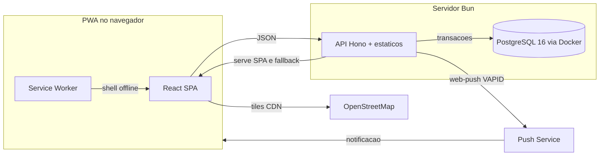

# XepaJá

XepaJá é um Progressive Web App que conecta feirantes e mercearias locais a moradores da região: o comerciante publica ofertas de alimentos ainda próprios para consumo ao fim do expediente (com desconto ou grátis) e o consumidor reserva uma unidade e retira presencialmente com um código único. Pagamento, quando houver, acontece presencialmente fora do app.

## Visão geral

Dois perfis, sem perfil operacional no MVP:

- Comerciante: administra estabelecimento (com GPS de retirada), cadastra itens, publica ofertas com foto, decide sobre pedidos pendentes, confirma retiradas por código, encerra ou cancela ofertas.
- Consumidor: busca ofertas por raio (até 100 km), reserva uma unidade por vez, cancela dentro do prazo, apresenta o código na retirada.

Regras centrais: uma reserva ativa por consumidor, retenção atômica de unidade (sem overbooking), 1 ou 2 faltas mandam o pedido para pendência de 30 min com aceite do comerciante, 3 faltas bloqueiam por 10 dias, tolerância de 15 min após a janela na retirada. Toda decisão crítica é validada no servidor.

## Arquitetura

Front React e API Hono no mesmo processo Bun; PostgreSQL em container com transações na reserva (SELECT ... FOR UPDATE), aceite, recusa, cancelamento, expiração e retirada. Mapas via Leaflet (CDN) com tiles OSM. Push com fallback para avisos internos.

## Estrutura

- `src/api/` — API Hono (auth, ofertas, reservas, retirada, avisos, push, estabelecimentos; db.ts com schema e migrate)
- `src/web/` — front React (telas por perfil, mapa, PWA)
- `src/shared/` — tipos compartilhados
- `tools/` — `dev.ts` (watch), `build.ts`, `seed.ts` (massa demo idempotente), `reset-test-db.ts`
- `tests/` — suíte de QA dos critérios de aceitação
- `public/` — shell PWA (manifesto, service worker, seed-photos demo); `public/dist` é o bundle gerado
- `data/` — uploads e chaves VAPID (gerado em runtime, fora do git; o banco mora no volume Docker)
- `docs/` — referência congelada e screenshots locais
- `.pi/mcp.json` — config do Playwright MCP para QA (ver AGENTS.md)
- `compose.yaml` (db + app), `compose.prod.yaml` + `Caddyfile` (TLS na VPS), `Dockerfile`

Detalhes de regras do projeto em `AGENTS.md`.

## Banco de dados

Persistência em PostgreSQL 16 (imagem postgres:16-alpine). Suba antes de tudo:

- docker compose up -d db: sobe o Postgres local (volume xepaja-pgdata, porta 5432).
- Copie .env.example para .env e ajuste se preciso. DATABASE_URL aponta para o banco de dev; DATABASE_URL_TEST para o banco de teste dedicado (xepaja_test).
- A API e o watch aguardam o banco e rodam o migrate sozinhos; GET /api/health retorna db: up e 503 com db: down se o banco cair.

## Como rodar após o clone

Pré-requisitos: Bun 1.x, Docker, Node com npx e Chrome instalado. Todos os comandos a partir da raiz do repo, sempre com bun:

    bun install
    docker compose up -d db
    bun run db:migrate
    bun run watch &
    bun run seed
    curl http://localhost:3000/api/health

- App em http://localhost:3000, API sob `/api`.
- `bun run watch` sobe API com restart automático e rebuild do front com reload (aguarda o Postgres e roda o migrate antes); use `watch:api` ou `watch:web` para cada parte.
- `bun test` recria o banco xepaja_test do zero e roda a suíte sem tocar no banco de dev; `bun run check` roda o tsc.
- Contas demo do seed: `comercio-banca@exemplo.com`, `cliente-zeca@exemplo.com` e outras em `tools/seed.ts` (senhas no próprio arquivo, só para demo local).
- QA de interface via Playwright MCP: no agent pi, conceda trust ao projeto para ativar `.pi/mcp.json` e confira em `/mcp` que `playwright` conectou.

Variáveis de ambiente (ver .env.example): `PORT` (padrão 3000), `DATABASE_URL` e `DATABASE_URL_TEST`, `XEPAJA_URL` (padrão http://localhost:3000, usada pelo seed), `VAPID_PUBLIC_KEY` / `VAPID_PRIVATE_KEY` / `VAPID_SUBJECT` (sem elas, chaves geradas uma vez em `data/vapid.json`), `SESSION_TTL_DAYS` (padrão 7), `COOKIE_SECURE=1` (cookies seguros em produção HTTPS).

## Demo na VPS

- Exija portas 80/443 e DNS apontando para a VPS; defina DOMAIN e XEPAJA_URL=https://<dominio> no .env.
- docker compose -f compose.yaml -f compose.prod.yaml up -d --build: sobe db + app + Caddy (TLS automático).
- Na VPS, rode o seed contra a URL pública: XEPAJA_URL=https://<dominio> bun run seed.

## Endpoints

- POST /api/auth/signup com name, cpf, email, password, role e, para consumer, search_radius_km. Retorna 201 com o usuário e cookie de sessão.
- POST /api/auth/login com email e password. Erro sempre genérico para não revelar se o e-mail existe.
- POST /api/auth/logout encerra a sessão atual.
- GET /api/auth/me retorna o usuário da sessão ou 401.
- PATCH /api/users/me atualiza nome e, para consumer, o raio.
- GET /api/establishments/mine, POST /api/establishments e PATCH /api/establishments/mine (só merchant). Trocar o endereço exige GPS novo na mesma requisição (422 sem ele). Resposta inclui can_publish e publish_block_reason.
- GET, POST /api/items e PATCH, DELETE /api/items/:id (só merchant, exige estabelecimento).
- POST /api/offers cria rascunho (só merchant com GPS). GET /api/offers/mine lista com itens, restante e estado derivado.
- POST /api/offers/:id/publish valida foto, composição, preço e datas, congela endereço e GPS e vira publicada.
- PATCH /api/offers/:id edita livre sem reservas; com reservas ativas só orientações, resto volta 409.
- POST /api/offers/:id/encerrar e POST /api/offers/:id/cancel com reason (cascata com avisos, sem falta).
- POST /api/offers/:id/photo com multipart campo photo (jpeg, png, webp, até 5 MB). GET /api/offers/:id/photo serve o arquivo.
- GET /api/offers/nearby com lat, lng e radius_km opcional (padrão o raio da conta). Só publicadas vigentes dentro do raio, ordenadas por distância, com distance_km.
- GET /api/offers/:id com detalhe e composição. Publicada abre a qualquer autenticado; rascunho alheio volta 404.
- POST /api/reservations com offer_id e idempotency_key (só consumer, bloqueado volta 403). Confirmada direta sem faltas com código único; pendente de 30 minutos com 1 ou 2 faltas.
- GET /api/reservations/active e /history com limites, faltas e bloqueio. POST /api/reservations/:id/cancel no prazo sem falta.
- GET /api/reservations/incoming e POST /:id/accept, /:id/refuse e /:id/merchant-cancel com motivo (só merchant dono).
- GET /api/notices com não lidos e POST /api/notices/:id/read.
- POST /api/reservations/pickup/confirm com code (só merchant dono). Uso único, tolerância de 15 minutos após o fim, aviso ao consumidor.
- GET /api/push/vapid-key, POST /api/push/subscribe e /unsubscribe por aparelho (só autenticado). Todo aviso tenta push sem bloquear; o aviso interno é o fallback.
- POST /api/auth/password/forgot responde sempre igual; POST /api/auth/password/reset com token único de 1 hora, uso único, mata sessões. Sem e-mail no MVP: o código sai no log do servidor.

## NFR e deploy

- A API valida tudo no servidor; o front só antecipa formato.
- GPS do consumidor vai só por query no nearby e nunca é persistido.
- Dev local em http; produção com HTTPS via Caddy (compose.prod.yaml) à frente da app.
- Carga local medida em ~130 ms; meta de 3 s com folga em rede local.

## Notas de PWA e offline

Sem rede não há confirmação de reserva: a API é a fonte da verdade e o service worker nunca responde /api do cache. Navegações offline caem em offline.html.

## Tecnologias e linguagens

Linguagens: TypeScript (API, front, tools e testes), HTML e CSS (shell PWA), SQL (schema e migrate do PostgreSQL).

- Runtime e tooling: Bun 1.x (dev server, build, testes, migrations, seeds).
- Frontend: React 19 como PWA instalável (manifesto + service worker + tela offline).
- Backend: Hono 4, único lugar que decide estoque, faltas e bloqueio.
- Banco: PostgreSQL 16 em container Docker, transações em todas as operações críticas.
- Push e mapas: Web Push com chaves VAPID; Leaflet 1.9.4 via CDN com tiles OpenStreetMap (mapas degradam sem rede, o resto funciona).
- QA: Playwright MCP com Chrome (config em `.pi/mcp.json`).

## Licença

MIT — ver LICENSE.md.
