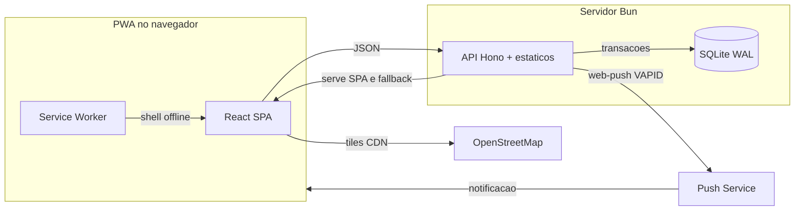

# XepaJá

XepaJá é um Progressive Web App que conecta feirantes e mercearias locais a moradores da região: o comerciante publica ofertas de alimentos ainda próprios para consumo ao fim do expediente (com desconto ou grátis) e o consumidor reserva uma unidade e retira presencialmente com um código único. Pagamento, quando houver, acontece presencialmente fora do app.

## Visão geral

Dois perfis, sem perfil operacional no MVP:

- Comerciante: administra estabelecimento (com GPS de retirada), cadastra itens, publica ofertas com foto, decide sobre pedidos pendentes, confirma retiradas por código, encerra ou cancela ofertas.
- Consumidor: busca ofertas por raio (até 100 km), reserva uma unidade por vez, cancela dentro do prazo, apresenta o código na retirada.

Regras centrais: uma reserva ativa por consumidor, retenção atômica de unidade (sem overbooking), 1 ou 2 faltas mandam o pedido para pendência de 30 min com aceite do comerciante, 3 faltas bloqueiam por 10 dias, tolerância de 15 min após a janela na retirada. Toda decisão crítica é validada no servidor.

## Arquitetura

Front React e API Hono no mesmo processo Bun; SQLite em arquivo único com transações na reserva, aceite, recusa, cancelamento, expiração e retirada. Mapas via Leaflet (CDN) com tiles OSM. Push com fallback para avisos internos.

## Estrutura

Tudo do projeto vive em `src/` (a raiz do repo só tem docs e configs):

- `src/api/` — API Hono (auth, ofertas, reservas, retirada, avisos, push, estabelecimentos)
- `src/web/` — front React (telas por perfil, mapa, PWA)
- `src/shared/` — tipos compartilhados
- `src/tools/` — `dev.ts` (watch), `build.ts`, `seed.ts` (massa demo idempotente)
- `src/tests/` — suíte de QA dos critérios de aceitação
- `src/public/` — shell PWA (manifesto, service worker, seed-photos demo)
- `src/data/` — sqlite local, uploads e chaves VAPID (gerado em runtime, fora do git)
- `docs/` — referência congelada e screenshots locais
- `.pi/mcp.json` — config do Playwright MCP para QA (ver AGENTS.md)

Detalhes de desenvolvimento em `src/README.md`; regras do projeto em `AGENTS.md`.

## Tecnologias e linguagens

Linguagens: TypeScript (API, front, tools e testes), HTML e CSS (shell PWA), SQL (schema e migrations do SQLite).

- Runtime e tooling: Bun 1.x (dev server, build, testes, migrations, seeds).
- Frontend: React 19 como PWA instalavel (manifesto + service worker + tela offline).
- Backend: Hono 4, unico lugar que decide estoque, faltas e bloqueio.
- Banco: SQLite em arquivo unico, modo WAL, transacoes em todas as operacoes criticas.
- Push e mapas: Web Push com chaves VAPID; Leaflet 1.9.4 via CDN com tiles OpenStreetMap (mapas degradam sem rede, o resto funciona).
- QA: Playwright MCP com Chrome (config em `.pi/mcp.json`).

## Como rodar após o clone

Pré-requisitos: Bun 1.x, Node com npx e Chrome instalado.

    cd src
    bun install
    bun run db:migrate
    bun run watch &
    bun run seed
    curl http://localhost:3000/api/health

- App em http://localhost:3000, API sob `/api`.
- `bun run watch` sobe API com restart automático e rebuild do front com reload; use `watch:api` ou `watch:web` para cada parte.
- `bun test` recria o banco de teste e roda a suíte; `bun run check` roda o tsc.
- Contas demo do seed: `comercio-banca@exemplo.com`, `cliente-zeca@exemplo.com` e outras em `tools/seed.ts` (senhas no próprio arquivo, só para demo local).
- QA de interface via Playwright MCP: no agent pi, conceda trust ao projeto para ativar `.pi/mcp.json` e confira em `/mcp` que `playwright` conectou.

Variáveis de ambiente (todas opcionais): `PORT` (padrão 3000), `XEPAJA_DB` (padrão `data/xepaja.sqlite`), `XEPAJA_URL` (padrão http://localhost:3000, usada pelo seed), `VAPID_PUBLIC_KEY` / `VAPID_PRIVATE_KEY` / `VAPID_SUBJECT` (sem elas, chaves geradas uma vez em `data/vapid.json`), `SESSION_TTL_DAYS` (padrão 7), `COOKIE_SECURE=1` (cookies seguros em produção HTTPS).

## Licença

MIT — ver LICENSE.md.
